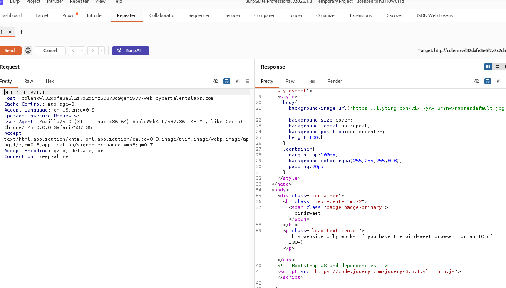
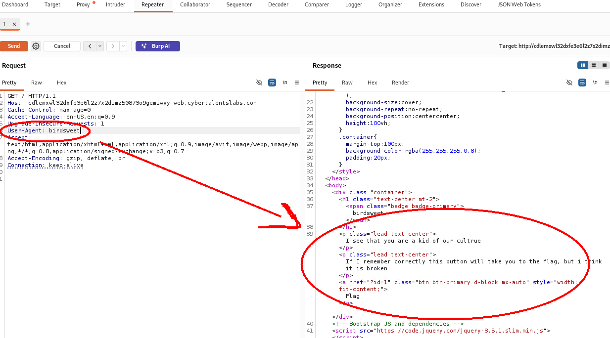

# Birdsweet — CyberTalents CTF Write-up

## Challenge Information

- **Platform:** CyberTalents
- **Challenge:** Birdsweet
- **Category:** Web Security
- **Tools:** Burp Suite, Web Browser
- **Skills:** HTTP Headers, Request Analysis, Parameter Testing

## 1. Challenge Overview

The objective of this challenge was to analyze the web application's behavior and identify how HTTP request manipulation affected the displayed content.

## 2. Initial Analysis

I opened the challenge in a web browser and inspected the application's behavior using Burp Suite.

I captured the HTTP request and examined the request headers and response.



## 3. User-Agent Manipulation

I modified the `User-Agent` header in Burp Suite Repeater and sent the request again.

The application responded differently and displayed a button labeled `Flag`.

(screenshots/2.png)

## 4. Parameter Investigation

I inspected the HTML associated with the button and observed the following link:

```html
<a href="?id=1">Flag</a>
```

I tested the `id` parameter and received the response `No flag here`.

This demonstrated that the tested value did not retrieve the expected result.

## 5. Solution

**Successful request:** [GET /?id=26 HTTP/1.1  >>>> User-Agent: birdsweet.] (screenshots/5.png)(screenshots/6.png)

**Observation:** [Oh yeah a flag. But it doesnt look right: 526d78685a33745251305a4254586c7a4d314e72546c5a6862454a775a47314f64324645536c426b6257524c557a466b646c6c36566a4a5456305a555557786163464d78556b315262466f785456527363466f7a576e4657526b4a565431565354565a73516c6c5457465a505a444253646b39564e58566c57464a345430565763316472576d786c52546c765647354b51315259556e5a6956545677537a4643526c4a7252546c5156316c3557544a464d6b314556586c5a656b6c3654577073615531485754313943673d3d.]


## 6. Key Takeaways

- Analyzed HTTP requests and response behavior.
- Practiced modifying HTTP headers with Burp Suite Repeater , Intruder and Decoder.
- Inspected HTML links and query parameters.
- Used response comparison to investigate application behavior.

## 7. Tools Used

- Burp Suite 
- Kali Linux
- Web Browser

---

*This write-up documents my analysis of the authorized CyberTalents CTF challenge.*
